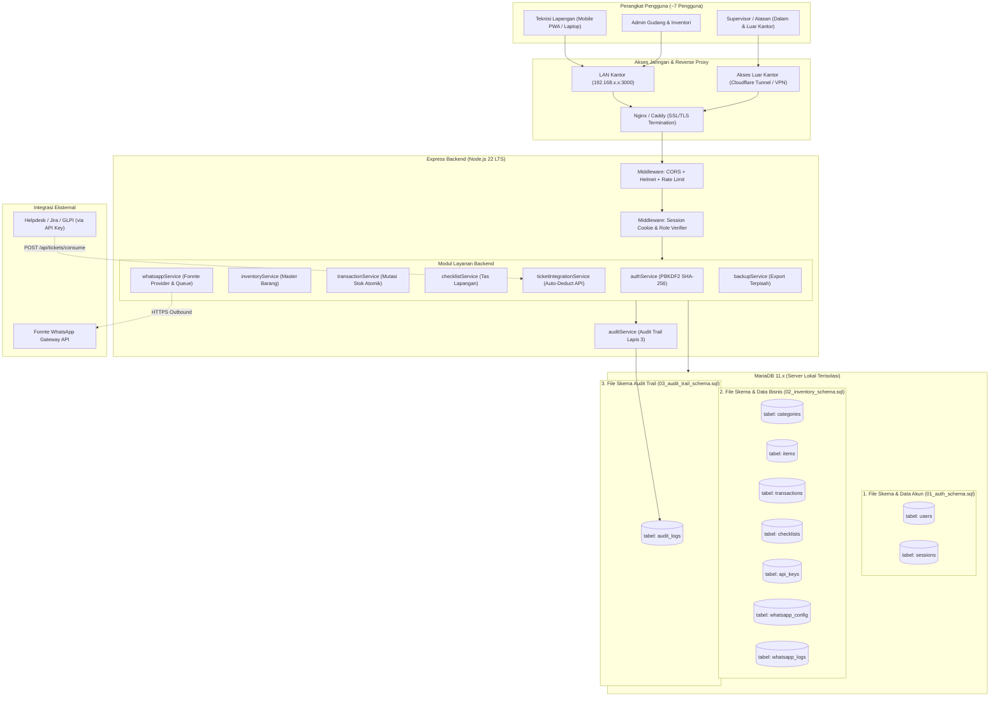

# DOKUMEN ARSITEKTUR SISTEM (ARCHITECTURE.MD)
**Aplikasi**: FieldOps IT Inventory (Rebuild)  
**Database Mesin**: MariaDB 11.x (Server Lokal)  
**Arsitektur**: Decoupled Monorepo (`frontend/` + `backend/`) dengan Docker Compose  
**Status**: Tahap 1 - Spesifikasi & Rencana Disetujui Pengguna

---

## 🏛️ 1. Diagram Arsitektur Sistem (Mermaid)

---

## 🗄️ 2. Desain Database MariaDB & Pemisahan Dua File Data

Sesuai instruksi mutlak pengguna: **Data item dengan data akun dipisahkan menjadi dua file yang berbeda**, baik dalam struktur skema SQL, berkas *seeding*, maupun berkas ekspor cadangan (*backup/restore*).

### A. File 1: Data Akun & Sesi (`01_auth_schema.sql` & `auth_seed.json`)
Hanya memuat entitas pengguna dan verifikasi hak akses:
1. **Tabel `users`**:
   - `id` (VARCHAR(36) PRIMARY KEY)
   - `username` (VARCHAR(64) UNIQUE NOT NULL)
   - `name` (VARCHAR(128) NOT NULL)
   - `email` (VARCHAR(128) UNIQUE NOT NULL)
   - `role` (ENUM('technician', 'admin', 'supervisor') NOT NULL)
   - `department` (VARCHAR(128))
   - `phone` (VARCHAR(32))
   - `password_hash` (VARCHAR(256) NOT NULL - PBKDF2 SHA-256 100k)
   - `salt` (VARCHAR(64) NOT NULL - 16 bytes hex)
   - `status` (ENUM('ACTIVE', 'SUSPENDED', 'PENDING_APPROVAL') DEFAULT 'ACTIVE')
   - `created_at`, `updated_at` (TIMESTAMP)
2. **Tabel `sessions`**:
   - `session_id` (VARCHAR(64) PRIMARY KEY)
   - `user_id` (VARCHAR(36) NOT NULL, FK -> users.id)
   - `ip_address` (VARCHAR(45))
   - `user_agent` (TEXT)
   - `expires_at` (TIMESTAMP NOT NULL)
   - `created_at` (TIMESTAMP DEFAULT CURRENT_TIMESTAMP)

### B. File 2: Data Bisnis Inventaris & Barang (`02_inventory_schema.sql` & `items_seed.json`)
Sama sekali **tidak menyimpan hash, salt, atau kredensial akun**. Relasi ke pengguna hanya berupa atribut `user_id`:
1. **Tabel `categories`**:
   - `id` (VARCHAR(36) PRIMARY KEY)
   - `code` (VARCHAR(16) UNIQUE NOT NULL - misal: 'CAB', 'NET')
   - `name` (VARCHAR(128) NOT NULL)
   - `description` (TEXT)
2. **Tabel `items`**:
   - `id` (VARCHAR(36) PRIMARY KEY)
   - `sku` (VARCHAR(64) UNIQUE NOT NULL)
   - `barcode` (VARCHAR(64) UNIQUE)
   - `name` (VARCHAR(256) NOT NULL)
   - `category_id` (VARCHAR(36) NOT NULL, FK -> categories.id)
   - `quantity` (INT NOT NULL DEFAULT 0, CHECK (quantity >= 0))
   - `min_stock_alert` (INT NOT NULL DEFAULT 2)
   - `unit` (VARCHAR(32) NOT NULL DEFAULT 'pcs')
   - `location` (VARCHAR(128))
   - `specs` (TEXT)
   - `unit_cost` (DECIMAL(15,2) DEFAULT 0.00)
   - `status` (ENUM('NORMAL', 'LOW_STOCK', 'OUT_OF_STOCK') NOT NULL DEFAULT 'NORMAL')
   - `is_deleted` (BOOLEAN DEFAULT FALSE) - Soft delete
   - `deleted_at` (TIMESTAMP NULL)
   - `created_at`, `updated_at` (TIMESTAMP)
3. **Tabel `transactions`**:
   - `id` (VARCHAR(36) PRIMARY KEY)
   - `type` (ENUM('IN', 'OUT', 'ADJUST') NOT NULL)
   - `item_id` (VARCHAR(36) NOT NULL, FK -> items.id)
   - `quantity` (INT NOT NULL)
   - `previous_qty` (INT NOT NULL)
   - `new_qty` (INT NOT NULL)
   - `reference_type` (VARCHAR(64))
   - `reference_number` (VARCHAR(128))
   - `recipient_destination` (VARCHAR(256))
   - `user_id` (VARCHAR(36) NOT NULL)
   - `notes` (TEXT)
   - `created_at` (TIMESTAMP DEFAULT CURRENT_TIMESTAMP)
4. **Tabel `checklists` & `checklist_items`**:
   - Pelacakan isi tas teknisi lapangan sebelum berangkat.
5. **Tabel `whatsapp_config` & `whatsapp_logs`**:
   - Menyimpan kredensial Fonnte dari env & riwayat pengiriman secara persisten.

### C. File 3: Audit Trail Log (`03_audit_trail_schema.sql`)
1. **Tabel `audit_logs`**:
   - `id` (BIGINT AUTO_INCREMENT PRIMARY KEY)
   - `user_id` (VARCHAR(36) NOT NULL)
   - `action` (VARCHAR(64) NOT NULL - misal: 'CREATE_ITEM', 'STOCK_OUT', 'DELETE_ITEM')
   - `table_name` (VARCHAR(64) NOT NULL)
   - `record_id` (VARCHAR(36) NOT NULL)
   - `before_state` (JSON)
   - `after_state` (JSON)
   - `ip_address` (VARCHAR(45))
   - `created_at` (TIMESTAMP DEFAULT CURRENT_TIMESTAMP)

---

## 🔒 3. Desain Autentikasi & Otorisasi Server
1. **Otentikasi Server-Authoritative**:
   - Klien mengirim username dan password ke `POST /api/auth/login`.
   - Backend memverifikasi hash PBKDF2 menggunakan salt akun dari tabel `users`.
   - Jika valid, backend membuat ID sesi unik, menyimpannya di tabel `sessions`, dan menyetel cookie:
     `Set-Cookie: fieldops_session=<sid>; HttpOnly; Secure; SameSite=Lax; Path=/`
2. **Penegakan Hak Akses (RBAC)**:
   - Setiap endpoint diproteksi oleh middleware `requireAuth` dan `requireRole(['admin', 'supervisor'])`.
   - Peran dibaca dari database sesi server, **bukan dari request body klien**.
   - Klien hanya menerima objek profil non-sensitif (`{ id, name, username, role, department }`) untuk mengatur tampilan UI.
3. **Skrip Setup Admin Pertama**:
   - Perintah `npm run setup:admin` pada backend meminta input interaktif username, email, dan password admin pertama. Tidak ada akun default dengan password statis di lingkungan produksi.

---

## 🌐 4. Analisis Pilihan Akses Jarak Jauh (Remote Access) untuk Kantor ISP

Berdasarkan kebutuhan akses atasan dari luar kantor ke server lokal:

| Parameter | Opsi A: Cloudflare Tunnel (Direkomendasikan) | Opsi B: VPN Kantor (WireGuard / Tailscale) |
| :--- | :--- | :--- |
| **Kebutuhan IP Publik** | **Tidak Perlu IP Publik** (bekerja mulus di balik CGNAT ISP) | Memerlukan IP publik statis di router kantor atau koordinasi server relay |
| **Konfigurasi Port** | **Nol Port Forwarding** (tidak ada port dibuka ke publik) | Port VPN harus dibuka di firewall router kantor |
| **Keamanan Database** | Database MariaDB tetap di internal network; hanya backend web yang diteruskan | Aman dalam tunnel VPN, tetapi klien VPN bisa mengakses subnet lokal jika tidak di-isolasi |
| **Sertifikat SSL/HTTPS** | Otomatis disediakan oleh Cloudflare (Wajib untuk PWA & Service Worker) | Harus membuat sertifikat sendiri atau self-signed CA |
| **Kemudahan Pengguna** | Atasan cukup membuka URL domain (misal: `https://inventory.kantor.com`) dari browser mana saja | Atasan wajib menginstal aplikasi VPN di smartphone/laptop dan menyalakannya sebelum login |

**Rekomendasi**: Menggunakan **Opsi A (Cloudflare Tunnel)** karena aman, tidak membuka port router kantor, dan otomatis menyediakan HTTPS untuk operasional PWA teknisi di ponsel.

---

## 🏷️ 5. Definisi Status Barang & Progres

### A. Status Stok Barang Fisik (`items.status`)
1. **`NORMAL`**: Stok berada di atas batas minimum (`quantity > min_stock_alert`). Kartu/baris berwarna hijau atau netral.
2. **`LOW_STOCK`**: Stok menipis atau berada di batas minimum (`quantity > 0 AND quantity <= min_stock_alert`). Memunculkan badge peringatan kuning dan memicu notifikasi WhatsApp ke tim logistik.
3. **`OUT_OF_STOCK`**: Stok fisik kosong (`quantity = 0`). Memunculkan badge merah dan memicu alert prioritas tinggi.

### B. Status Mutasi Transaksi (`transactions.type`)
1. **`IN`**: Barang masuk (pengadaan PO baru, retur lapangan, atau pengembalian teknisi).
2. **`OUT`**: Barang keluar (keperluan insiden tiket teknisi, pemeliharaan BTS/ODC, atau serah terima unit).
3. **`ADJUST`**: Penyesuaian stok saat opname berkala (koreksi fisik vs data).

---

## 📦 6. Konfirmasi Sumber Data Tunggal & Rencana Dependensi

1. **Sumber Data Tunggal**:
   - Sesuai temuan audit, workspace `'default'` (*Kantor Pusat*) adalah satu-satunya sumber data master riil (12 item barang, 16 transaksi, 6 kategori). Workspace cabang bandung & surabaya kosong dan dihapus.
2. **Permohonan Persetujuan Dependensi**:
   - Backend membutuhkan driver MariaDB: **`mysql2`** (`npm install mysql2`).
   - Sesuai aturan *"Jangan tambah dependency baru tanpa bertanya"*, mohon persetujuan untuk dependensi `mysql2` ini agar backend Express dapat berkomunikasi dengan MariaDB.
